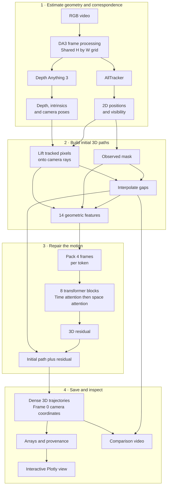
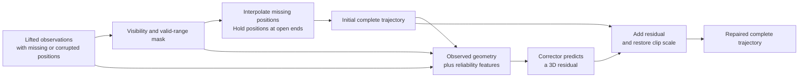
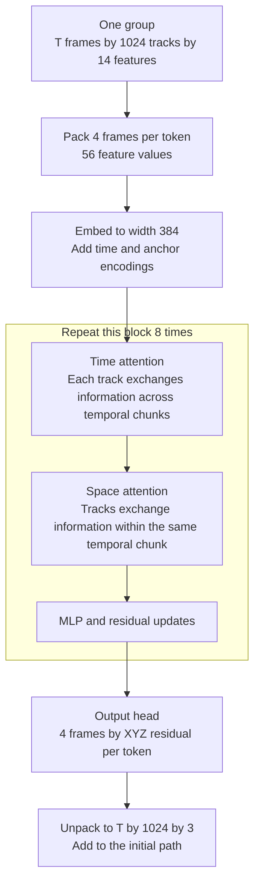
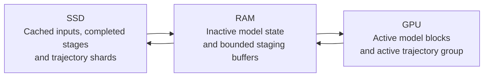

# ReLift Architecture

ReLift combines three models with explicit geometry. A 2D tracker identifies where each reference pixel moves in the video. A geometry model estimates depth and camera motion. ReLift's own transformer repairs the resulting 3D trajectories, including gaps where the tracked surface is hidden.

The identity of a point comes from its pixel in the first processed frame. The output follows that same point through time; it does not create a new unrelated point cloud for each frame.

## The complete path from video to trajectories



This is a dependency diagram, not a claim that all branches execute concurrently. The existing demo runs DA3 first and AllTracker second. DA3 supplies the processed images used by AllTracker, and the stages run sequentially on the GPU. The repair model then uses the geometry and tracking outputs together.

## What each model contributes

| Component | Question it answers | Inputs | Outputs used here |
|---|---|---|---|
| Depth Anything 3 | How far away are visible surfaces, and where is the camera? | The RGB clip | Depth maps, camera intrinsics, camera poses, processed RGB frames |
| AllTracker | Where does this first-frame pixel move in each later image? | The processed RGB clip | Dense 2D positions and visibility for first-frame pixels |
| ReLift corrector | Which lifted positions are inconsistent, and how should the trajectory continue through missing observations? | Geometry, visibility and an interpolated initial trajectory | A 3D residual added to the initial trajectory |

The default geometry checkpoint is `DA3NESTED-GIANT-LARGE-1.1`. The released ReLift corrector has about 19.1 million parameters, with width 384, eight transformer blocks and six attention heads. The corrector does not consume RGB images. The front ends handle appearance; the repair stage operates on geometric observations and their reliability.

The repository also has adapters for VGGT-Omega and 4RC geometry and for CoWTracker 2D tracking. These adapters produce a common representation so the same released corrector checkpoint can be used across provider combinations. The default local demos use DA3 plus AllTracker.

## Point identity and the shared grid

Let `T` be the number of frames and `H × W` the resolution DA3 produces. The default long side is 504. A landscape demo commonly becomes `280 × 504`, which gives **141,120 reference points**.

For reference pixel `(v, u)`, AllTracker produces one 2D position in each frame. The complete tracking tensor has shape `(T, H, W, 2)`. Its last two spatial indices still identify the original first-frame pixel, even after the tracked location moves elsewhere in the image.

This distinction is important when an object becomes hidden: the point still has an identity and a trajectory to estimate. It does not become the identity of whatever surface is now visible at its predicted image location.

AllTracker also returns confidence, which the demo saves. The default corrector observation rule uses visibility and positive range; confidence is not a separate channel in its 14-feature input.

## From a tracked pixel to a 3D observation

At each tracked image position, the lift samples DA3's depth map. Intrinsics convert the pixel into a camera ray; the estimated pose expresses that ray in a shared coordinate system. The code represents the observation as:

```text
3D position = camera centre + distance along ray × unit ray direction
X_t(p)      = o_t           + r_t(p)                × d_t(p)
```

DA3's depth is a camera-axis depth, not directly the Euclidean range along an oblique ray. The lift accounts for the normalized image coordinates when converting depth to range. Poses are made relative to the first camera, so all output frames share the first camera's coordinates rather than moving with each later camera.

This lets the representation account for camera motion while estimating surface motion. Its units come from the geometry provider; the visualizer's axis values are not a guarantee of measured metric accuracy. CUDA nearest-neighbor depth sampling is preserved because the repository documents different CPU rounding behavior.

For intuition, imagine a ball passing behind a person. The tracker may still predict the ball's image location, while the depth map at that location describes the person. A naive lift can pull the ball's 3D track onto the person's surface. The visibility mask and corrector are intended to handle this kind of error.

## Missing observations and the initial trajectory

The default observed mask requires tracker visibility greater than `0.85` and positive range. The reference frame is treated as observed. Hidden observations are withheld from the feature input rather than trusted as measurements of the tracked surface.

Before applying the learned model, `interp_init` fills each track's missing positions by linear interpolation between observed frames. It holds the nearest observed position constant at an open end. It also records the distance in frames to the nearest observation. This produces a complete initial path and a description of where it is weakly supported.



The final result is learned repair rather than interpolation alone. Observed positions also remain eligible for a correction; the architecture does not hard-clamp every observed cell to its initial lift. Reference pixel IDs remain unchanged throughout.

## What the corrector sees

The clip uses one normalization scale: the median first-frame depth over valid reference points. Features are expressed relative to each track's reference anchor. This reduces sensitivity to the geometry provider's overall scale.

| Feature | Channels | Purpose |
|---|---:|---|
| Interpolated position relative to the anchor | 3 | The initial complete path |
| Observed lifted position relative to the anchor | 3 | The available 3D evidence, masked when unobserved |
| Observed flag | 1 | Which cells have observations |
| Distance to the nearest observation | 1 | How far a missing segment is from supporting evidence; capped at 40 frames |
| Observed unit ray direction | 3 | The viewing direction associated with an observation |
| Camera centre relative to the reference camera | 3 | Camera motion through the clip |
| Total | 14 | Geometry and reliability, with no RGB channels |

Position-related features use the model's internal factor of ten. The predicted residual is divided by that factor before it is added to the normalized initial trajectory, and the clip scale is restored afterward. Keeping this order matters for numerical agreement when the implementation changes memory placement.

## How the transformer combines time and other tracks

Inference shuffles the valid reference pixels once using a CUDA generator with seed zero. It forms groups of **1,024 tracks**, then processes up to **eight independent groups** per forward call. A group is a scatter of points across the scene, not a contiguous image tile. Attention can share evidence among points in the same group; different groups do not attend to each other in that call.

Four consecutive frames of a track are packed into one token. The embedding maps `4 × 14 = 56` feature values to width 384, then adds time and 3D-anchor position encodings. Each of eight blocks alternates attention along time and attention across tracks, followed by an MLP.



Time attention supplies motion context along a point's trajectory. Space attention lets a point use related motion and geometry elsewhere in its group. The model head is initialized to zero during model construction, so an untrained model returns the interpolated path; the released checkpoint supplies the learned residuals.

The implementation pads the time dimension to a multiple of four and discards that padding after correction. It also pads the final point batch by repeating some tracks. The baseline documents undefined write order for those duplicate points, which is why offload parity tests must identify and report them separately.

The published evaluation recipe uses 84-frame windows. Training code samples lengths 48, 68 and 84. Longer clips can run as one sequence, but they are outside those training lengths; running 206 or 294 frames is a capacity and generalization extension rather than an equivalent published benchmark setting.

## Training and inference are different paths

The demo does not train any model. It loads the released front-end and corrector weights, estimates the clip geometry and 2D motion, and runs the repair model once over each point group.

Corrector training uses clean 3D trajectories from PointOdyssey windows. The corruption code simulates lifting errors, tracker dropouts, occlusions, and false-visible observations with an occluder's depth. The model learns to predict residuals that recover the clean trajectories. The loss combines position error and four times velocity error, with extra weight on moving tracks and hidden cells. Because this training representation is geometric, the corrector is not tied to one image tracker or geometry network.

## Outputs and their visual interpretation

The existing demo's `tracks.npz` contains the dense corrected `(T, H, W, 3)` array, the interpolated raw lift, observation mask, processed RGB frames, camera poses, intrinsics, and run metadata. Each `(v, u)` slice is a first-frame point's entire 3D trajectory. The optional comparison video projects raw and repaired paths back onto the processed images using the estimated cameras.

The Plotly viewer displays a uniform subset of at most 2,500 reference points while retaining every temporal frame for those points. Point colours come from the first RGB frame. Blue lines show selected representative motion paths; clicking a point highlights its complete raw and repaired paths in orange. Spatial display sampling does not reduce the dense trajectory output.

## Where the current implementation spends memory

There are two distinct bottlenecks. DA3 can fail while evaluating an active layer and retaining backbone features across the complete clip. Later, the existing correction path loads complete observation fields and allocates complete output trajectories on CUDA. Plotly export also loads dense arrays before sampling them.

Writing final results to disk addresses the later dense-array allocations, but it cannot recover GPU space needed by a DA3 layer that already failed. The offload work therefore has two parts: move inactive model state and retained features between GPU and RAM, and stream bounded trajectory groups through correction into disk-backed arrays. Disk becomes backing storage for cold state when the RAM budget requires it. These placement changes must preserve full temporal context and the mathematical path described above.



This last diagram describes the implemented offload path. Full-resolution running and forest capacity trials now complete;
the [benchmark report](offload-benchmark-results.md) separates those outcomes from latency and parity measurements.
The [offload design and benchmark plan](memory-offload-design.md) defines the memory budgets and comparison protocol.

## Where to read the implementation

| Concern | Source |
|---|---|
| Single-video orchestration and serialization | [scripts/demo_video.py](../scripts/demo_video.py) |
| Geometry and tracker adapters | [relift/providers](../relift/providers) |
| CUDA ray construction and camera conversion | [relift/rays.py](../relift/rays.py) |
| Interpolation, normalization and feature construction | [relift/features.py](../relift/features.py) |
| Corrector transformer | [relift/model.py](../relift/model.py) |
| Dense grouping and inference | [relift/infer.py](../relift/infer.py) |
| Synthetic training observations | [relift/corrupt.py](../relift/corrupt.py) |
| Training objective and window lengths | [relift/train.py](../relift/train.py) |
| Offline interactive export | [scripts/plotly_demo.py](../scripts/plotly_demo.py) |
| Demo catalog and resumable gallery batch | [scripts/generate_all_views.py](../scripts/generate_all_views.py) |
| Provider and corrector settings | [configs/providers.yaml](../configs/providers.yaml), [configs/eval/table1.yaml](../configs/eval/table1.yaml) |

## Interactive component map

[Open the standalone architecture viewer](architecture-view.html) for the component diagram,
this complete walkthrough and a browser of the referenced source files. Selecting a component
highlights its connections and shows its inputs, outputs and an exact numbered code excerpt.
Its source link opens the complete embedded file at the referenced line. The viewer works offline
as a single HTML file, including the walkthrough's rendered diagrams.

```bash
uv sync --extra dev
uv run python scripts/build_architecture_view.py
node docs/architecture-view.test.cjs
```

The editable component templates are `architecture-view.template.html`, `architecture-view.css`
and `architecture-view.js`. The standalone page uses `architecture-standalone.template.html`,
`architecture-standalone.css` and `architecture-standalone.js`. The [builder](../scripts/build_architecture_view.py) reads this Markdown
document and the current source using Python's AST, recording filenames, line ranges and file
checksums. It accepts `--out PATH` for another destination. Rebuild after source or documentation
edits to refresh the snapshot. Component selection is remembered in the browser when local storage
is available; no conversation host is required.

The pinned Mermaid bundle and its MIT license live under `docs/vendor/mermaid/`. Normal builds
verify their recorded checksums and require no network. `scripts/fetch_architecture_assets.py`
reproduces the asset download and rejects changed bytes after the initial checksums are recorded.
