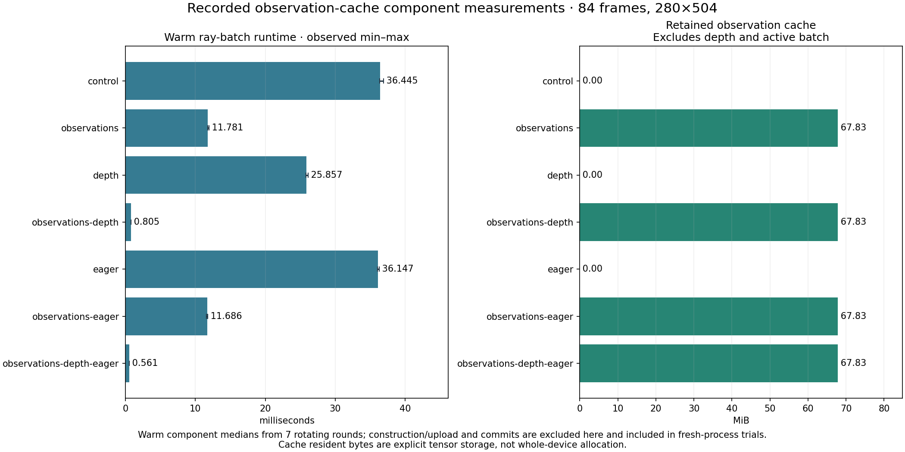

# Budgeted observation-cache experiment

This follows the corrected CUDA ray profile. Warm ray construction spends more
time gathering mapped tracker coordinates and visibility on the CPU than computing
camera directions. The earlier C++ gathering experiment did not establish a speedup.
This experiment changes placement: cache immutable tracker data on the GPU and
gather only the selected point batch there, using existing PyTorch operations.

## Implementation and boundaries

`observation_cache_mb` is a separate budget, defaulting to zero. If the original
coordinate and visibility tensors fit, `ObservationCache` uploads them in 16-frame
blocks, retaining their original float16/float32 dtypes. Each call uploads the
ordered int64 pixel IDs and returns a new float32 coordinate/visibility batch with
`index_select`. Duplicate IDs, full timelines and frame-only selection are preserved.
Returned batches do not alias cache storage.

This is a capacity/performance tradeoff, not reduced precision. The source maps
remain available. The target bounds retained tensors, not allocator reservation,
process memory or active-batch tensors. Depth caching has its own existing budget;
the two allocations are additive. CUDA free-memory headroom is checked before
allocation. A cache that cannot fit records `budget_declined` or
`headroom_declined` and uses the current mapped path. Partial allocation failures
release cache ownership and propagate the error.

The cache has an explicit owner and `close()`. Stream usage is recorded on its
resident tensors. Streamed inference closes its lookahead worker before releasing
the cache, including on failure. No process-global cache is introduced.

`InferenceComponents.observation_cache_factory` supplies an injectable implementation
with the same `active`, `gather(ids, frame)`, `metrics` and `close()` interface and a
stable fingerprint. A positive observation-cache budget replaces CPU gathering;
simultaneously selecting a Python/C++/injected CPU gather is rejected explicitly.
It composes independently with depth caching, ray backends and prefetch.

## Measurement plan

Freeze the source before and after this change. Keep all input/checkpoint bytes,
processing resolution, timeline, groups, batch size, precision and commits fixed.
The primary comparison uses current PyTorch rays, isolating only observation
placement. Alternate control/cached order over five fresh processes for correction
and then five fresh full-video-pipeline pairs. Include cache construction/upload,
input preparation, inference, hashing and durable output commits in process timing.
Preserve all trials, ranges and resource measurements.

A separate warm component script rotates seven combinations over seven rounds of
five calls. It records construction, resident/source/upload bytes, pixel-ID traffic
and separate CPU/CUDA traces. An all-frame/all-pixel scan compares raw ray results
bitwise before interpreting timing. Warm component results exclude construction
and do not predict the full-pipeline reduction.

Use one-trial correction checks for depth-cache/eager-ray combinations and unchanged
defaults. These are functional validations, not latency distributions. Repeat all
primary output comparisons, including padded points and raw lift. Audit running
and forest ray coverage without reducing their temporal or spatial resolution.
This experiment does not change DA3/AllTracker inference or the corrector.

Cache upload bytes can be similar to, or exceed, the sum of selected tracker
uploads in a single dense pass: pixel-ID uploads add traffic, and most original
points are already visited once. The hypothesis concerns CPU gathering and transfer
granularity, not a promised reduction in total PCIe bytes.

## Initial component result

For 84 frames × 8,192 selected points of swing-tire, seven rotating warm rounds give:

| Settings | Median ray-batch milliseconds |
|---|---:|
| Current PyTorch | 36.445 |
| Observation cache | 11.781 |
| Depth cache | 25.857 |
| Both caches | 0.805 |
| Eager CUDA rays | 36.147 |
| Observation cache + eager CUDA rays | 11.686 |
| Both caches + eager CUDA rays | 0.561 |

Observation caching alone reduces this component time by **67.7%**. Both caches
reduce it by **97.8%**. All six candidate configurations match current PyTorch
bitwise over **11,854,080** real frame/reference-pixel pairs, including directions,
ranges, origins and visibility. These are component measurements, not pipeline
speedup claims.

The observation cache retains and initially uploads **71,124,480 bytes**
(**67.83 MiB**) in 12 uploads for this clip. It preserves float16 source tensors,
then gathers float32 batches. Per-process runtime counters are written to
`observation-cache.json`; construction-time placement is recorded in store
provenance. Counters are not used as changing resume identity.

## Fresh-process results

Five paired processes alternate control/cached order in each comparison. All
pipeline runs decode and process the complete 84-frame clip. The isolated
correction fixture keeps exactly the same prepared inputs.

| Scope | Current | Observation cache | Change in process median |
|---|---:|---:|---:|
| Correction process seconds | 10.641 [10.471–10.764] | 10.026 [9.902–10.297] | −5.8% |
| Full video pipeline seconds | 60.865 [51.087–70.969] | 52.432 [50.522–61.805] | Observed −13.9%; attribution limited |

The cache is faster in **all five isolated correction pairs**. Correction-stage
medians are **8.699 → 8.166 seconds**. In the pipeline trials, correction-stage
medians are **8.262 → 7.660 seconds**, with four of five stage pairs faster. These
results include cache setup/upload and output commits. The standalone and
in-pipeline correction measurements support a roughly **0.5–0.6 second** saving
on this workload.

The much larger full-pipeline difference must not be attributed entirely to the
cache. DA3 stage medians differ **40.155 → 36.043 seconds**, although the observation
cache is created only after DA3 and tracking finish. OS page cache was retained,
but checkpoint reads and storage latency varied; physical read counters range
from approximately zero to 2.46 GiB in these runs. No uniformly warm/cold cache
policy or frontend performance change is established. All runs remain in the
records. A 13.9% causal pipeline speedup is not an accepted conclusion.

The actual cache is active in every cached run, retaining **67.83 MiB**. Each dense
run initially uploads **71,124,480 bytes** in 12 cache uploads and subsequently
uploads **2,259,456 bytes** of selected pixel IDs across 19 calls. These counters
describe cache-owned traffic, not all pipeline transfers. No reduction in total
tracker PCIe traffic is claimed.

Sampled correction device peak increases **3.888 → 3.958 GiB**; sampled whole-pipeline
device peak remains **12.406 GiB**, dominated by earlier stages. Physical writes
remain approximately **0.388 GiB** for correction and **0.586 GiB** for the full
pipeline. OS RSS high water is approximately **1.53 GiB** for correction and
**13.55 GiB** for the full pipeline in both arms. Sampling can miss short peaks,
and device totals include desktop use. The new cache trades a small amount of
correction-stage VRAM for less CPU work; it does not replace model offloading or
establish a host-RAM saving.

The separate synchronized diagnostics support the mechanism: inclusive ray time
falls **0.816 → 0.392 seconds** over 19 calls, while corrector time stays
**3.666 → 3.661 seconds**. These are instrumented spans, excluding cache
construction outside `rays`; they are not headline process timings and cannot be
added to overlapping preparation/commit spans.

Keep `observation_cache_mb=0` as the default. The positive correction result supports
an explicit workload-appropriate budget. In particular, a 128 MiB budget fits
swing-tire's stored tracker tensors but declines the larger running/forest clips;
their ray-validation runs use 512 MiB. The actual state and bytes are recorded so
an inactive budget cannot be presented as an active-cache benchmark.

## Correctness and coverage

All **21** full-output comparisons pass: nine isolated correction comparisons,
nine full-pipeline comparisons, two combination checks and one unchanged-default
check. Ordinary XYZ, repeated padded XYZ and raw lift are bitwise equal, with exact
prepared arrays, masks, images and camera data. No tolerance was relaxed.

The real-input ray scans cover all **82,414,080** frame/reference-pixel pairs across
swing-tire (84 frames), running (206) and forest (294), separately for all six
candidate combinations. Every direction, range, origin and visibility value is
bitwise equal to the current path. These long-clip checks reuse prepared geometry
and tracks; they are not new full-video inference benchmarks. The long-clip caches
retain 166.34 MiB and 237.40 MiB respectively under explicit 512 MiB budgets.

The final suites pass **128 CPU** and **46 GPU** checks, covering original dtypes,
noncontiguous sources, ordered/repeated/empty IDs, bounds, cache decline, partial
allocation cleanup, failure cleanup, other CUDA streams, prefetch, ray/depth
combinations, defaults and resume. A final compatibility guard preserves legacy
dtype conversion when the cache is disabled; positive caching requires supported
float16/float32 source tensors.

## Reproduction

Use fresh output/snapshot paths. The original local snapshots are
`outputs/experiments/observation-cache-before-source` and
`outputs/experiments/observation-cache-source`.

In a fresh checkout of this PR with its Git history, reconstruct those algorithms:

```bash
uv run python scripts/prepare_optimization_sources.py \
  --revisions configs/experiments/observation-cache-revisions.json
```

The measured inference code is preserved in commit `18502599df61`; `HEAD` denotes
the final PR with the disabled-cache compatibility guard and published records.
The map reconstructs committed variants, not every original working-snapshot byte.
Recorded source hashes identify the measured code. The cache-only path requires no custom native build; supply a
matching `--cuda` build explicitly for eager-CUDA combination checks.

```bash
uv run python scripts/profile_observation_cache.py \
  --source outputs/experiments/observation-cache-source \
  --build outputs/native/da3-final \
  --window outputs/benchmarks/offload-primary/swing-tire/ram/trial-01/output/window \
  --out outputs/experiments/observation-cache-profile-recheck
uv run python scripts/run_optimization_experiments.py \
  --spec configs/experiments/observation-cache.json --experiment correction
uv run python scripts/check_optimization_parity.py \
  outputs/experiments/observation-cache/correction --all-trials
uv run python scripts/run_optimization_experiments.py \
  --spec configs/experiments/observation-cache.json --experiment pipeline
uv run python scripts/check_optimization_parity.py \
  outputs/experiments/observation-cache/pipeline --all-trials
```

The runner spec points to the recorded local prepared fixture. Provision it first
or substitute a new fixture path and output root. `--resume` reuses saved trials
and does not constitute a new inference benchmark. Raw technical records and plots
are generated separately from this analysis.

Compact technical records and the component figure are published under
[`docs/benchmarks/observation-cache`](../benchmarks/observation-cache/summary.json).



Regenerate tables, records and charts from persisted outputs:

```bash
uv run python scripts/summarize_optimization_experiments.py \
  outputs/experiments/observation-cache --roles configs/experiments/observation-cache-roles.json
uv run python scripts/publish_observation_cache.py \
  --campaign outputs/experiments/observation-cache \
  --profile outputs/experiments/observation-cache-profile/summary.json \
  --audit outputs/experiments/observation-cache-running-rays/summary.json \
  --audit outputs/experiments/observation-cache-forest-rays/summary.json \
  --roles configs/experiments/observation-cache-roles.json \
  --out docs/benchmarks/observation-cache
uv run python scripts/build_optimization_charts.py \
  --summaries outputs/experiments/observation-cache/summary.json \
  --out-dir outputs/observation-cache-charts
```
