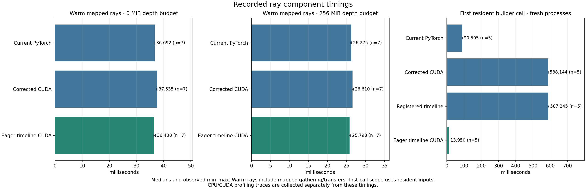

# Corrected CUDA ray profiling

The camera kernel is faster than the equivalent eager PyTorch operations. The
largest isolated fresh-call overhead comes from first dispatch through the Python
registered operator. The corrected integration also adds warm overhead by rotating and cleaning each
16-frame block, copying strided coordinates for each block, and dispatching a
registered operator for each block. The tested improvement moves rotation back
to the full timeline, retains the original PyTorch operation and output strides,
and copies coordinates once. It does not change the CUDA arithmetic or compiler
flags. A second change uses a validated eager launch of that same kernel, avoiding
registered dispatch during normal inference. Both changes are measured separately.

The final eager timeline backend is selected explicitly with `rays="cuda_timeline"`. Existing
`current`, `python` and `cuda` selections retain their behavior. The default is
still `current`. An injected builder can implement `camera(coords, depth, K)` and
`rotate(rotation, camera)` to use the same blocked-camera/full-timeline protocol;
the original four-argument callable contract remains supported.

## What the profile measures

The persistent [profiling script](../../scripts/profile_cuda_rays.py) uses real
swing-tire coordinates and the pinned native binary. It separates resident-tensor
math from mapped CPU gathering, host copies and transfers. After three warmups,
seven rounds rotate the backend order, with five calls per backend per round.
CUDA events and synchronized wall timings are saved independently of instrumented
CPU/CUDA traces. CUDA event spans include gaps between host submissions and must
not be interpreted as kernel execution time alone.

For 16 frames × 8,192 points with inputs already resident, corrected CUDA takes
**0.151 ms**, versus **0.408 ms** for eager PyTorch. The bare camera launch takes
about **0.018 ms** including host launch and completion overhead. The profiler's
camera-kernel device time is approximately **0.009 ms**. Optimizing its division
or square-root instructions is a small opportunity in the current workload.

With the actual mapped gathering and transfers included, the measured warm medians
are:

| Depth cache budget | Current PyTorch | Corrected block CUDA | Registered timeline ablation |
|---|---:|---:|---:|
| 0 MiB | 36.892 ms | 37.543 ms | 36.780 ms |
| 256 MiB | 26.296 ms | 26.634 ms | 25.981 ms |

These are one full-timeline ray batch of 84 frames × 8,192 points. Registered timeline CUDA
reduces the corrected CUDA time by **2.0% without caching** and **2.4% with
caching**. It is only **0.3% / 1.2%** below current PyTorch in this test. The cached
timeline samples include a 29.768 ms outlier; all samples remain in the technical
record. These are warm component measurements, not a full-pipeline speedup claim.

The uncached trace shows the mechanism directly:

| Per ray batch | Current PyTorch | Corrected block CUDA | Timeline CUDA |
|---|---:|---:|---:|
| Rotation (`aten::bmm`) calls | 1 | 6 | 1 |
| `cudaLaunchKernel` events | 35 | 31 | 15 |
| Coordinate layout copies before native calls | 0 | 6 | 1 |

When the bounded depth cache already contains the clip, timeline CUDA also runs
camera construction over the full resident timeline in one call. Without that
cache it retains 16-frame depth blocks. It never loads a full depth clip merely
to enable this optimization. Final direction sanitization stays after rotation;
moving it ahead of rotation would change NaN/Inf behavior.

CPU-side mapped gathering and array copies take most of the remaining wall time;
the uncached trace also contains eight pageable host-to-device copies taking
about 6 ms of device time. Kernel fusion cannot eliminate those costs. The profile
does not explain a previous whole-correction timing difference solely through
camera-kernel execution. Fresh matching trials are needed to distinguish a small
ray improvement from model and filesystem variation.

## First-call isolation and eager dispatch

The [startup benchmark](../../scripts/benchmark_ray_startup.py) starts a new process
for every sample, provisions identical resident inputs, loads the native binary,
then measures factory construction and the first call separately. It does not
warm up the builder before the first call. Five rounds rotate all four arms.

| 16-frame resident builder | Median first call | Median factory construction |
|---|---:|---:|
| Eager PyTorch | 90.505 ms | <0.001 ms |
| Corrected registered CUDA | 588.144 ms | 3.597 ms |
| Registered timeline ablation | 587.245 ms | 3.598 ms |
| Validated eager timeline CUDA | 13.950 ms | <0.01 ms |

The eager first call is **97.6% shorter** than corrected registered CUDA. This is
a startup component result, not a 97.6% inference speedup. Input provisioning,
Python imports and native loading are recorded separately and remain outside this
specific first-call metric; whole-process correction trials include them.
Other work in a longer-lived process may already have paid some lazy-initialization
cost, so the same 574 ms saving must not be assumed for every video pipeline.

The pinned PyTorch implementation wraps custom-op backend functions with
`torch._disable_dynamo` (`torch/_library/custom_ops.py`). First dispatch lazily
imports compiler machinery. Keeping the same camera math and rotation while
switching registered versus eager timeline dispatch reproduces the large first-call
difference. It is not CUDA compilation: the same explicitly prebuilt binary is
loaded before either measurement. Warm component timing alone missed this cost.

The eager path retains dtype/device/shape/gradient and pixel-bound validation,
input contiguity normalization, CUDA device guards, caller-stream execution and
native launch-error checks. `TimelineRayBuilder(native, registered=True)` keeps the
registered operator and fake implementation available for explicit graph
experiments. Normal inference selects eager dispatch; corrector compilation remains
an independent setting. No complete ray-graph compilation claim is made.

The final eager implementation's warm mapped-ray medians are **36.438 ms uncached**
and **25.798 ms cached**, versus **37.535 / 26.610 ms** for matching corrected CUDA
and **36.692 / 26.275 ms** for matching current PyTorch. That is **2.9% / 3.1%**
below corrected CUDA, and **0.7% / 1.8%** below current PyTorch. These seven-round
rotating comparisons are separate from the earlier registered-timeline ablation.

## Registered timeline ablation: fresh correction results

All fifteen unprofiled correction runs completed, using the same source snapshot,
prepared bytes, checkpoint, settings and environment. Only `rays` changes. Mode
order rotates across five repeats; caching and prefetch are disabled.

| Backend | Fresh process median [min–max], seconds | Correction stage median, seconds |
|---|---:|---:|
| Current PyTorch | 18.420 [18.019–20.348] | 16.489 |
| Corrected block CUDA | 19.099 [17.260–19.299] | 17.076 |
| Registered timeline CUDA | 19.249 [18.124–20.745] | 17.171 |

The ray-only improvement **does not produce a correction-runtime improvement** in
this campaign. Timeline CUDA's process median is 0.8% above corrected CUDA, with
overlapping observed ranges; it is 4.5% above current PyTorch. It is faster than
corrected CUDA in only one of the five matched repeat positions. No repeat is
discarded. Sampled device memory is 3.886 GiB for all three; sampled tree RSS is
1.535 / 1.585 / 1.580 GiB, and physical writes are 0.388 GiB per arm.

This ablation does not justify a new default. It retains the registered dispatch
startup cost. Its component improvement falls below the proposed 10% target, so
it does not justify a ten-run frontend/full-pipeline confirmation. The eager
follow-up is measured independently; no full video-pipeline speedup is claimed.

## Eager timeline follow-up: fresh correction results

The second campaign again uses five fresh processes per arm, with rotating order
and unchanged prepared input, model, precision, groups, batches and commits.

| Backend | Fresh process median [min–max], seconds | Correction stage median, seconds |
|---|---:|---:|
| Current PyTorch | 16.702 [16.590–18.248] | 14.808 |
| Corrected block CUDA | 18.897 [14.425–20.415] | 16.834 |
| Eager timeline CUDA | 18.148 [10.580–18.527] | 16.252 |

Eager timeline's process median is **4.0% below corrected CUDA**, and it is faster
in four of five matched repeat positions. However, it is **8.7% above current
PyTorch** in this campaign. The large overlapping ranges do not establish a
reliable correction-wide speedup. In particular, the 10.580-second run is retained
but is not selected as a headline result. The earlier registered ablation is not
pooled into this comparison.

Sampled device memory is approximately 3.89 GiB for all three; sampled tree RSS
is 1.537 / 1.575 / 1.472 GiB, and physical writes remain 0.388 GiB per arm. Sampling
does not establish a strict memory ceiling or an RSS reduction. Durable commit
behavior and integrity checks are unchanged.

The result is a repeatable first-call and warm-ray improvement over corrected
CUDA, with **no accepted end-to-end speedup over current PyTorch**. Keep it opt-in.
Before promoting it, use a separately planned five-pair full video-pipeline study
and investigate filesystem variability; changing inference defaults based on this
correction-only comparison would not be justified.

The synchronized diagnostics support the attribution: inclusive ray spans total
**2.007 s** for corrected CUDA, **1.948 s** for registered timeline, and **0.961 s**
for eager timeline (19 calls each). Current PyTorch totals **1.077 s**. Corrector
spans remain approximately **3.66–3.69 s** for all four. These instrumented runs
inflate Python costs and are not unprofiled timings. Their `fsync` self times are
**6.29–8.09 s**, with roughly **2.03–2.08 s** in SHA updates. Inclusive spans overlap;
do not add them together or subtract diagnostic totals as an inference speedup.

For another experiment, prioritize eliminating repeated CPU coordinate/visibility
gathers and transfers, or isolating the commit-time variability. A separately
budgeted GPU observation cache could avoid work that a faster camera kernel
cannot remove. That would be a new capacity tradeoff and should be measured
independently. This patch does not weaken hashing, fsync or recovery behavior.

## Correctness

The original corrected CUDA math remains unchanged. The extended audit compares
every one of **11,854,080** real frame/reference-pixel pairs through the full
`MappedObservations` integration, rather than only standalone 16-frame builder
calls. Origins, directions, ranges and visibility are **bitwise equal** to current
PyTorch with depth caching disabled and enabled. The separate nearest-pixel audit
also reports zero mismatches.

Regression coverage includes arithmetic across small/large point counts and
rotation layouts, nonfinite coordinates, direct operator validation, nondefault
streams, 35-frame block boundaries, repeated IDs, frame-only calls, cached depth,
prefetch and independent native gather/packing/writer combinations. No tolerance
was relaxed. This evidence applies to the tested PyTorch/CUDA/GPU configuration,
not every library version or GPU.

The local suites pass **123 CPU** and **37 GPU** checks. Every completed timing
repeat is compared separately against its campaign's first current-PyTorch control,
including ordinary XYZ, repeated padded XYZ and raw lift. All **28** full-output
comparisons pass, with those three trajectory categories bitwise equal. Compact technical
records and component figures are published under
[`docs/benchmarks/cuda-ray-profile`](../benchmarks/cuda-ray-profile/summary.json).



## Reproduction and records

The corrected control and initial candidate snapshots remain under
`outputs/experiments/rays-profile-before-source` and
`outputs/experiments/rays-timeline-v2-source`; the final eager snapshot is
`outputs/experiments/rays-timeline-eager-source`. Native source and binary hashes,
runtime versions, commands, seeds, telemetry and every timing sample are retained.
Use a fresh output directory for each run.

In a fresh checkout of this PR with its Git history, reconstruct the supported
algorithms from the revision map, then build the native helper explicitly:

```bash
uv run python scripts/prepare_optimization_sources.py \
  --revisions configs/experiments/cuda-ray-source-revisions.json
uv run python scripts/build_native.py \
  --source outputs/experiments/rays-timeline-eager-source \
  --out outputs/native/da3-final --cuda --cxx g++-13
```

`HEAD` denotes this profiling PR. This reconstructs committed algorithm variants,
not every byte of the original working snapshots. Provision the inputs/checkpoint
and create the prepared window first, or substitute its path in the commands and
spec. Existing snapshot/build/output destinations are never overwritten.

```bash
uv run python scripts/profile_cuda_rays.py \
  --source outputs/experiments/rays-timeline-eager-source \
  --build outputs/native/da3-final \
  --window outputs/benchmarks/offload-primary/swing-tire/ram/trial-01/output/window \
  --out outputs/experiments/rays-profile-recheck
uv run python scripts/audit_cuda_rays.py \
  --source outputs/experiments/rays-timeline-eager-source \
  --build outputs/native/da3-final \
  --window outputs/benchmarks/offload-primary/swing-tire/ram/trial-01/output/window \
  --mapped-backend cuda_timeline --out outputs/rays-timeline-audit-recheck.json
uv run python scripts/run_optimization_experiments.py \
  --spec configs/experiments/cuda-ray-timeline.json --experiment eager-correction
uv run python scripts/check_optimization_parity.py \
  outputs/experiments/rays-timeline/eager-correction --all-trials
uv run python scripts/benchmark_ray_startup.py \
  --source outputs/experiments/rays-timeline-eager-source \
  --build outputs/native/da3-final \
  --window outputs/benchmarks/offload-primary/swing-tire/ram/trial-01/output/window \
  --out outputs/experiments/rays-startup-recheck
```

The experiment spec uses five fresh processes per arm and rotates three-arm order.
It includes decoding neither video nor model frontends: this is correction from
identical prepared inputs, including model loading, mapped preparation, inference,
conversion, hashing and durable commits. Profiler runs are a separate experiment.
The spec's recorded output root must be changed for a fresh campaign.

Regenerate technical records/figures independently of this analysis document:

```bash
uv run python scripts/summarize_optimization_experiments.py outputs/experiments/rays-timeline
uv run python scripts/publish_ray_profile.py \
  --campaign outputs/experiments/rays-timeline \
  --profile outputs/experiments/rays-profile-eager/summary.json \
  --startup outputs/experiments/rays-startup-eager/summary.json \
  --ablation-profile outputs/experiments/rays-profile-balanced/summary.json \
  --ablation-startup outputs/experiments/rays-startup-registered/summary.json \
  --audit outputs/experiments/rays-timeline-audit.json \
  --audit outputs/experiments/rays-timeline-eager-audit.json \
  --out docs/benchmarks/cuda-ray-profile
uv run python scripts/build_optimization_charts.py \
  --summaries outputs/experiments/rays-timeline/summary.json \
  --out-dir outputs/cuda-ray-profile-charts
```
